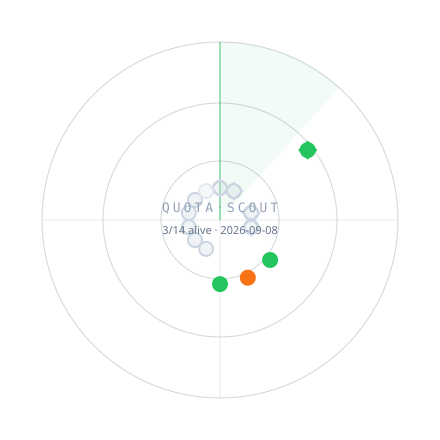

<div align="center">

# ⌁ QUOTA·SCOUT

**Free-Quota Radar for Official LLM Tiers**

*A tiny scout patrolling the free tier of the model galaxy: GitHub Actions live-probes official free quotas every 6 hours, so you always know who is still alive.*

**English** · [简体中文](README.zh-CN.md)

<!-- Badges light up automatically once the repo goes public (shields needs anonymous raw access); no code change required
<p>
  
  &nbsp;
  
  &nbsp;
  
</p>
-->



</div>

🇨🇳 **Mainland users: start with the first table, zero extra networking needed. 🌍 The global table is more powerful but network-dependent.**

> [!NOTE]
> Probes run from GitHub Actions (overseas runners): a result only proves “service alive + key valid”, **not** “reachable from mainland China”. The `direct ✓` tag is a hand-maintained snapshot; live CN-side probing is on the roadmap.

<!-- RADAR:START -->
### 🇨🇳 China-direct · works from mainland networks

| Channel | Network | Free tier (snapshot; official pages win) | Status | Latency | Last probe (UTC) | Key var | Sign up |
|---|---|---|---|---|---|---|---|
| [SiliconFlow](https://siliconflow.cn/) | `direct ✓` | Sign-up bonus credits plus always-free small models (small Qwen/GLM sizes)† | ⚪ awaiting key | — | — | `SILICONFLOW_API_KEY` | [Sign up](https://cloud.siliconflow.cn/account/ak) |
| [ModelScope](https://www.modelscope.cn/) | `direct ✓` | Daily-refreshed free inference calls; huge open-model catalog, mainland-friendly | ⚪ awaiting key | — | — | `MODELSCOPE_TOKEN` | [Sign up](https://www.modelscope.cn/my/myaccesstoken) |
| [Zhipu AI Open Platform (BigModel)](https://bigmodel.cn/) | `direct ✓` | Lightweight glm models (e.g. glm-4-flash) free for the long run via the standard /api/paas/v4 endpoint — billed separately from GLM Coding/Token plans; use a normal API key here, never your plan key | 🔑 key rejected | 693 ms | 2026-10-29T06:35:25Z | `ZHIPU_API_KEY` | [Sign up](https://bigmodel.cn/usercenter/proj-mgmt/apikeys) |
| [Alibaba Cloud Bailian (DashScope)](https://www.aliyun.com/product/bailian) | `direct ✓` | Time-limited free quota per model for new users†; some small Qwen tiers stay free long-run† | ⚪ awaiting key | — | — | `DASHSCOPE_API_KEY` | [Sign up](https://bailian.console.aliyun.com/?apiKey=1) |
| [Baidu Qianfan ModelBuilder](https://qianfan.cloud.baidu.com/) | `direct ✓` | Activity-based free trials on selected ERNIE/open models (varies — see console)† | ⚪ awaiting key | — | — | `QIANFAN_API_KEY` | [Sign up](https://console.bce.baidu.com/iam/#/iam/apikey/list) |

### 🌍 Global · usually needs international networking

| Channel | Network | Free tier (snapshot; official pages win) | Status | Latency | Last probe (UTC) | Key var | Sign up |
|---|---|---|---|---|---|---|---|
| [Google AI Studio (Gemini API)](https://aistudio.google.com/) | `intl net` | Permanent free tier with per-model daily/RPM limits — solid for personal use & prototyping | ✅ verified | 384 ms | 2026-10-29T06:35:25Z | `GEMINI_API_KEY` | [Sign up](https://aistudio.google.com/apikey) |
| [OpenRouter (:free models)](https://openrouter.ai/) | `intl net` | Models suffixed :free are callable at no cost (daily caps); a normal API key is required — anonymous access returned 401 as of 2026-08 | 🏷️ stale model | 110 ms | 2026-10-29T06:35:25Z | `OPENROUTER_API_KEY` | [Sign up](https://openrouter.ai/settings/keys) |
| [Groq Cloud](https://groq.com/) | `intl net` | Long-lived developer free tier, rate-limited; 2026-08 catalog led by gpt-oss/qwen (llama retired from the free list) | ✅ verified | 163 ms | 2026-10-29T06:35:25Z | `GROQ_API_KEY` | [Sign up](https://console.groq.com/keys) |
| [Cerebras Inference](https://cloud.cerebras.ai/) | `intl net` | Free tier with a generous daily token allowance; famously fast inference | ⚪ awaiting key | — | — | `CEREBRAS_API_KEY` | [Sign up](https://cloud.cerebras.ai/) |
| [Mistral La Plateforme](https://mistral.ai/) | `intl net` | Free plan on by default (no credit card), rate-limited; create keys in the Studio console | ⚪ awaiting key | — | — | `MISTRAL_API_KEY` | [Sign up](https://docs.mistral.ai/getting-started/quickstarts/studio/activate-and-generate-api-key) |
| [NVIDIA NIM (build.nvidia.com)](https://build.nvidia.com/) | `intl net` | Developer-program credit for a large amount of inference; broad open-model family | ⚪ awaiting key | — | — | `NVIDIA_API_KEY` | [Sign up](https://build.nvidia.com/explore/discover) |
| [GitHub Models](https://github.com/marketplace/models) | `intl net` | Call several mainstream models with any GitHub PAT. RETIRING — HTTP 410 brownout observed 2026-08-27; do not build on it | ⚪ awaiting key | — | — | `GITHUB_MODELS_TOKEN` | [Sign up](https://github.com/settings/tokens) |
| [Hugging Face Inference Providers](https://huggingface.co/docs/inference-providers) | `intl net` | Small monthly inference credits ship with every account; overflow goes pay-as-you-go | ⚪ awaiting key | — | — | `HF_TOKEN` | [Sign up](https://huggingface.co/settings/tokens) |
| [Cloudflare Workers AI](https://developers.cloudflare.com/workers-ai/) | `intl net` | Daily free neuron allocation; open multimodal models callable via Workers or REST | 📖 doc-only | — | — | `CF_WORKERS_AI_TOKEN` | [Sign up](https://dash.cloudflare.com/profile/api-tokens) |
<!-- RADAR:END -->

`†` = sign-up bonus driven (one-shot); expires fastest.

<details>
<summary><b>📖 Legend · How it works · Contribute</b></summary>

### Legend

| Icon | Meaning | Icon | Meaning |
|---|---|---|---|
| ✅ | Live-fire verified (key configured, call succeeded) | 🔑 | Key rejected (401/403) |
| 🟢 | Anonymous call succeeded | 🏷️ | Stale model ID, needs update |
| 🟡 | 429 rate-limited — service itself healthy | 💸 | Quota spent |
| ⚪ | No key configured, skipped | ❌ | Down (network / 5xx) |

On the radar: **diamond ring = mainland-direct channels, circle = global channels**; closer to center = lower latency; hollow blips are untested.

### Compliance boundary

Only tiers officially published by vendors (free plans / trials / sign-up credits). Reverse-engineered web-to-API channels are never listed.

### How it works

```
data/channels.json    Channel registry (SSOT): grouping, endpoints, model-ID snapshots, key var names
scripts/probe.py      Probe: an 8-token "ping" per channel — zero third-party dependencies
scripts/render.py     Bilingual status tables + SVG radar + shields badge data
.github/workflows/    cron every 6h: probe → render → auto-commit
data/history.jsonl    Rolling probe history (ready for trend charts)
```

Local run:

```bash
# Create the template ONLY if .env doesn't exist (never overwrite your keys!)
[ -f .env ] || cp .env.example .env

nano .env                              # edit the existing file
python3 scripts/probe.py                # full sweep
python3 scripts/probe.py --only groq    # single channel
```

### Contribute a channel

PRs against `data/channels.json`, hard requirements:

1. **Officially published free tier or trial credit** (compliance red line)
2. OpenAI-compatible chat completions endpoint preferred (so it can be probed)
3. Label honestly: `cn_access` (direct/intl) and `bonus_once` (one-shot credit)

</details>

## Disclaimer

Free-tier descriptions above are point-in-time snapshots; vendors change them at will — official pages always win. Probe traffic is tiny (8 tokens); don't abuse free quotas. This tool neither proxies nor distributes any keys.
