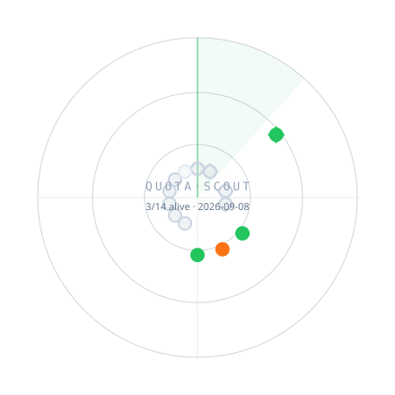

<div align="center">

# ⌁ QUOTA·SCOUT

**额度侦察兵 · 官方免费模型额度雷达**

*一枚替你巡逻免费星域的小雷达：GitHub Actions 每 6 小时对官方免费额度实弹探活，谁还活着，一眼可查。*

[English](README.md) · **简体中文**

<!-- 徽章在仓库转公开后自动亮起（shields 需匿名读取 raw JSON）；无需改代码
<p>
  
  &nbsp;
  
  &nbsp;
  
</p>
-->



</div>

🇨🇳 **国内用户看第一节即可零门槛开嫖；🌍 国际节能力更强但依赖网络环境。**

> [!NOTE]
> CI 自 GitHub Actions（海外节点）发起探测：结果只证明「服务存活且密钥有效」，**不等于大陆直连可达**。表中 `直连✓` 为人工标注快照。CN 侧双端探活已在 Roadmap。

<!-- RADAR:START -->
### 🇨🇳 国内额度 · 大陆直连优先

| 渠道 | 网络 | 免费方式（快照，以官方为准） | 状态 | 延迟 | 最后探测 (UTC) | 密钥变量 | 注册 |
|---|---|---|---|---|---|---|---|
| [SiliconFlow 硅基流动](https://siliconflow.cn/) | `直连✓` | 注册赠送体验金，另有多个常驻免费小模型（Qwen/GLM 小尺寸等）† | ⚪ 待密钥 | — | — | `SILICONFLOW_API_KEY` | [注册](https://cloud.siliconflow.cn/account/ak) |
| [ModelScope 魔搭社区](https://www.modelscope.cn/) | `直连✓` | 每日免费推理调用次数（刷新制），开源模型数量多，国内访问友好 | ⚪ 待密钥 | — | — | `MODELSCOPE_TOKEN` | [注册](https://www.modelscope.cn/my/myaccesstoken) |
| [智谱 BigModel 开放平台](https://bigmodel.cn/) | `直连✓` | glm-4-flash 等轻量模型长期免费调用；经标准端点 /api/paas/v4 按量/免费计费，与 GLM Coding/Token 订阅套餐相互隔离（套餐仅限专属端点+指定工具）。另建普通 Key 用于本工具，勿复用订阅 Key | 🔑 密钥无效 | 342 ms | 2026-09-15T17:06:02Z | `ZHIPU_API_KEY` | [注册](https://bigmodel.cn/usercenter/proj-mgmt/apikeys) |
| [阿里云百炼 DashScope](https://www.aliyun.com/product/bailian) | `直连✓` | 新用户各主流模型均有限时免费额度，部分通义小模型有常驻免费档† | ⚪ 待密钥 | — | — | `DASHSCOPE_API_KEY` | [注册](https://bailian.console.aliyun.com/?apiKey=1) |
| [百度千帆 ModelBuilder](https://qianfan.cloud.baidu.com/) | `直连✓` | 部分文心及开源模型提供限时免费试用额度（随活动变化，以控制台为准）† | ⚪ 待密钥 | — | — | `QIANFAN_API_KEY` | [注册](https://console.bce.baidu.com/iam/#/iam/apikey/list) |

### 🌍 国际额度 · 多数需国际网络

| 渠道 | 网络 | 免费方式（快照，以官方为准） | 状态 | 延迟 | 最后探测 (UTC) | 密钥变量 | 注册 |
|---|---|---|---|---|---|---|---|
| [Google AI Studio (Gemini API)](https://aistudio.google.com/) | `需国际网络` | 有永久免费层，按模型设每日/每分钟限额，适合个人体验与小规模开发 | ✅ 验证可用 | 502 ms | 2026-09-15T17:06:02Z | `GEMINI_API_KEY` | [注册](https://aistudio.google.com/apikey) |
| [OpenRouter (:free 模型)](https://openrouter.ai/) | `需国际网络` | 带 :free 后缀的模型可免费调用（每日限额）；需注册并配置 API Key，2026-08 实测匿名调用已返回 401 | 🟡 限流(服务正常) | 286 ms | 2026-09-15T17:06:02Z | `OPENROUTER_API_KEY` | [注册](https://openrouter.ai/settings/keys) |
| [Groq Cloud](https://groq.com/) | `需国际网络` | 开发者免费层，速率受限但长期可用；2026-08 目录以 gpt-oss/qwen/compound 系为主（llama 已下架） | ✅ 验证可用 | 406 ms | 2026-09-15T17:06:02Z | `GROQ_API_KEY` | [注册](https://console.groq.com/keys) |
| [Cerebras Inference](https://cloud.cerebras.ai/) | `需国际网络` | 免费层提供每日较大 token 配额，主打超高速推理 | ⚪ 待密钥 | — | — | `CEREBRAS_API_KEY` | [注册](https://cloud.cerebras.ai/) |
| [Mistral La Plateforme](https://mistral.ai/) | `需国际网络` | 免费模式默认开启（无需信用卡），有限速；在 Studio 控制台创建 API Key | ⚪ 待密钥 | — | — | `MISTRAL_API_KEY` | [注册](https://docs.mistral.ai/getting-started/quickstarts/studio/activate-and-generate-api-key) |
| [NVIDIA NIM (build.nvidia.com)](https://build.nvidia.com/) | `需国际网络` | 开发者计划赠送大量推理调用额度，开源模型家族齐全 | ⚪ 待密钥 | — | — | `NVIDIA_API_KEY` | [注册](https://build.nvidia.com/explore/discover) |
| [GitHub Models](https://github.com/marketplace/models) | `需国际网络` | 任意 GitHub 账号可用 PAT 调用多家主流模型。【2026-08-27 实测：平台进入退役 brownout（HTTP 410），即将下线，新用户勿再依赖】 | ⚪ 待密钥 | — | — | `GITHUB_MODELS_TOKEN` | [注册](https://github.com/settings/tokens) |
| [Hugging Face Inference Providers](https://huggingface.co/docs/inference-providers) | `需国际网络` | 所有注册用户每月附带少量免费推理 credit（约一周量级的轻度使用），超出后走付费 | ⚪ 待密钥 | — | — | `HF_TOKEN` | [注册](https://huggingface.co/settings/tokens) |
| [Cloudflare Workers AI](https://developers.cloudflare.com/workers-ai/) | `需国际网络` | 每日免费 neuron 分配，可在 Workers 内或 REST 调用多模态开源模型 | 📖 收录未探测 | — | — | `CF_WORKERS_AI_TOKEN` | [注册](https://dash.cloudflare.com/profile/api-tokens) |
<!-- RADAR:END -->

`†` = 以注册一次性赠送为主的渠道，用完即止，时效性最强。

<details>
<summary><b>📖 状态图例 · 工作原理 · 贡献指南</b></summary>

### 图例

| 图标 | 含义 | 图标 | 含义 |
|---|---|---|---|
| ✅ | 实弹验证可用（配密钥调用成功） | 🔑 | 密钥被拒（401/403） |
| 🟢 | 匿名调用成功 | 🏷️ | 模型 ID 失效，待更新 |
| 🟡 | 429 限流 —— 服务正常 | 💸 | 额度耗尽 |
| ⚪ | 未配置密钥，跳过探测 | ❌ | 不可用（网络失败 / 5xx） |

雷达图中：**菱形框 = 国内直连渠道，圆形 = 国际渠道**；离圆心越近延迟越低，空心点表示未实测。

### 合规边界

只收录厂商**官方公开**的免费层 / 试用额度 / 赠送金。不收录任何逆向 Web 转 API 的灰色渠道。

### 工作原理

```
data/channels.json   渠道登记表（分组、端点、模型 ID 快照、密钥变量名）
scripts/probe.py     探活：向每个渠道发一条 max_tokens=8 的 "ping"，零第三方依赖
scripts/render.py    双语状态表 + SVG 雷达图 + shields 动态徽章数据
.github/workflows/   cron 每 6 小时跑 probe → render → 自动 commit
data/history.jsonl   每次探测的滚动历史（可用于画趋势）
```

本地运行：

```bash
# 仅当 .env 不存在时才创建模板（防误覆盖已有 Key！）
[ -f .env ] || cp .env.example .env

nano .env                              # 增改 Key 都编辑这个既有文件
python3 scripts/probe.py                # 全量
python3 scripts/probe.py --only groq    # 单测一个渠道
```

### 贡献新渠道

给 `data/channels.json` 提 PR，硬性标准：

1. **官方免费层或明确公示的试用额度**（合规红线）
2. 提供 OpenAI 兼容 chat completions 端点者优先（可被自动探活）
3. 如实标注 `cn_access`（direct/intl）与 `bonus_once`（是否一次性赠送）

</details>

## 免责声明

表格中的免费额度描述为撰写时快照，厂商随时调整，一切以官方页面为准。探活请求极小（8 token），请勿滥用免费额度；本工具不代理、不分发任何密钥。
